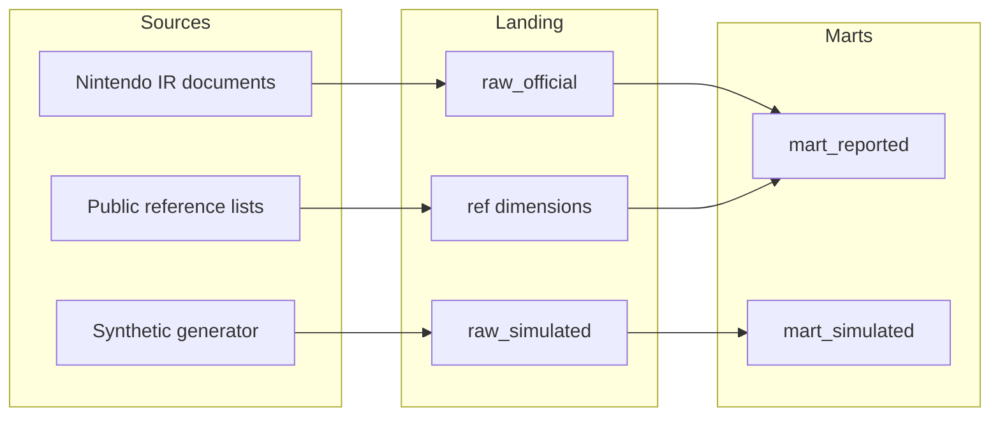

# Nintendo Intelligence Hub

Unofficial portfolio project for practicing business-intelligence engineering on public Nintendo disclosures. It is not affiliated with, endorsed by, or a disclosure channel for Nintendo. Nintendo product names are used only to identify public platforms and report structures.

This repository is a local warehouse, a star schema, tested grain rules, dbt views, a Streamlit shell, and a synthetic series that stays in its own schema. Official Nintendo figures are not committed. `nih init-db` leaves the official fact tables untouched. `nih ingest` downloads public IR files into gitignored `data/raw` and `data/cleaned` directories and can load the rows it parsed. A source that cannot be retrieved is reported unavailable.

## Grain in one paragraph

Nintendo's fiscal year ends on March 31. A column labeled Q1–Q3 is the April 1 through December 31 cumulative total. The October–December quarter is a different span. The warehouse stores the printed span. It derives a later quarter only by subtracting the immediately previous year-to-date total. Life-to-date title totals, company forecasts, and balance-sheet stocks stay on the disclosure grain. The full rules and a synthetic arithmetic example are in [docs/DATA_GRAIN.md](docs/DATA_GRAIN.md).

## Architecture



| Path | Role |
| --- | --- |
| `ingestion/` | Source catalog, downloads, parsers, and the synthetic weekly generator |
| `transformations/` | Derivation API and the dbt project |
| `warehouse/` | DDL, reference load, purity audit |
| `dashboards/` | Streamlit shell |
| `forecasting/` | Baseline that trains only on synthetic series |
| `monitoring/` | Collision checks and synthetic z-score alerts |
| `config/` | Settings, sources, and metrics |
| `docs/` | Architecture, grain, and the phased plan |

PostgreSQL is the default warehouse and needs no cloud account. BigQuery is optional. Setting `NIH_WAREHOUSE_TARGET=bigquery` without a project id fails closed. Details are in [docs/ARCHITECTURE.md](docs/ARCHITECTURE.md). The delivery phases are in [docs/IMPLEMENTATION_PLAN.md](docs/IMPLEMENTATION_PLAN.md).

## Quickstart

Requires Python 3.11+ and Docker.

```bash
python3 -m venv .venv
source .venv/bin/activate
python -m pip install --upgrade pip
pip install -e ".[dev]"
cp .env.example .env
docker compose up -d --wait
nih init-db
nih check --require-db
nih ingest
pytest
dbt parse --project-dir transformations/dbt --profiles-dir transformations/dbt
dbt build --project-dir transformations/dbt --profiles-dir transformations/dbt
streamlit run dashboards/app.py
```

Forecasting is a separate, independently runnable job (`python -m nih forecast run|status|history`) that backtests baseline and statistical models on annual official series, selects by expanding-window RMSE, and stores forecasts with residual intervals in the `forecast` schema — never in the official marts. Methodology, evaluation, and limitations are in [docs/FORECASTING_METHODOLOGY.md](docs/FORECASTING_METHODOLOGY.md), [docs/MODEL_EVALUATION.md](docs/MODEL_EVALUATION.md), and [docs/FORECAST_LIMITATIONS.md](docs/FORECAST_LIMITATIONS.md). Monitoring runs after a successful pipeline build and on demand with `python -m nih monitor run`; `python -m nih monitor status`, `history`, `ack`, and `resolve` inspect and manage alerts in `meta.monitoring_alerts`. Rules, thresholds, and notification setup are in [docs/MONITORING_ARCHITECTURE.md](docs/MONITORING_ARCHITECTURE.md), [docs/ALERT_DEFINITIONS.md](docs/ALERT_DEFINITIONS.md), and [docs/NOTIFICATION_SETUP.md](docs/NOTIFICATION_SETUP.md). The dashboard has five pages — Executive Overview, Hardware & Software, Regional Performance, Financial Intelligence, and Pipeline Health — documented in [docs/DASHBOARD_GUIDE.md](docs/DASHBOARD_GUIDE.md) and [docs/DASHBOARD_METRICS.md](docs/DASHBOARD_METRICS.md). Tableau-ready exports and connection instructions are in [docs/TABLEAU_INTEGRATION.md](docs/TABLEAU_INTEGRATION.md).

`make install`, `make db-up`, `make db-init`, `make test`, `make dbt-build`, and `make app` wrap those commands.

The Compose file publishes PostgreSQL on host port **54329**, database `nintendo_intel`, user `nih`. The password in `.env.example` is a local default.

`python -m nih pipeline run` is the orchestrated path: ingest, audit, `dbt build`, and a row in `meta.pipeline_runs`. Operations are documented in [docs/PIPELINE_OPERATIONS.md](docs/PIPELINE_OPERATIONS.md). `nih ingest` reads the Nintendo IR pages and historical workbooks documented in [docs/DATA_SOURCES.md](docs/DATA_SOURCES.md). The cleaned columns are in [docs/DATA_DICTIONARY.md](docs/DATA_DICTIONARY.md). Business definitions, lineage, example queries, and warehouse limits are in [docs/BUSINESS_METRICS.md](docs/BUSINESS_METRICS.md), [docs/DATA_LINEAGE.md](docs/DATA_LINEAGE.md), [docs/EXAMPLE_QUERIES.md](docs/EXAMPLE_QUERIES.md), and [docs/WAREHOUSE_LIMITATIONS.md](docs/WAREHOUSE_LIMITATIONS.md). IGDB stays unavailable until `NIH_IGDB_CLIENT_ID` and `NIH_IGDB_CLIENT_SECRET` are set. A licensed third-party file is optional and is not bundled.

Open the Streamlit URL printed in the terminal. The page shows fiscal spans, the source registry, and the metric catalog. The synthetic weekly count is a caption. Those quantities are not plotted as performance.

## Local reset

```bash
docker compose down -v
docker compose up -d --wait
nih init-db
```

`down -v` deletes the local Docker volume and the data in it.

## Tests

Unit tests cover the fiscal calendar, the cumulative-to-quarter rules, provenance, the synthetic forecast, and the span chart. They use obvious synthetic values and fiscal year 2099.

`pytest` also runs warehouse tests when PostgreSQL is up. Those tests roll back a synthetic disclosure pair and compare the Python derivation with the dbt view. If PostgreSQL is down, that group is skipped.

```bash
pytest -m "not integration"
```

## Project layout

```text
config/                  settings, sources, metrics
dashboards/              Streamlit shell
docs/                    architecture, grain, plan
forecasting/             synthetic baseline
ingestion/               catalogs and synthetic generator
monitoring/              collision and anomaly checks
nih/                     calendar, periods, settings, CLI
transformations/dbt/     staging views and marts
warehouse/ddl/           PostgreSQL schema
warehouse/seeds/         platform and region reference data
tests/                   unit and warehouse tests
```

## License

MIT. See [LICENSE](LICENSE).
