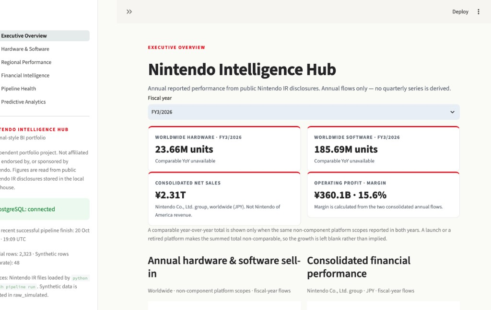
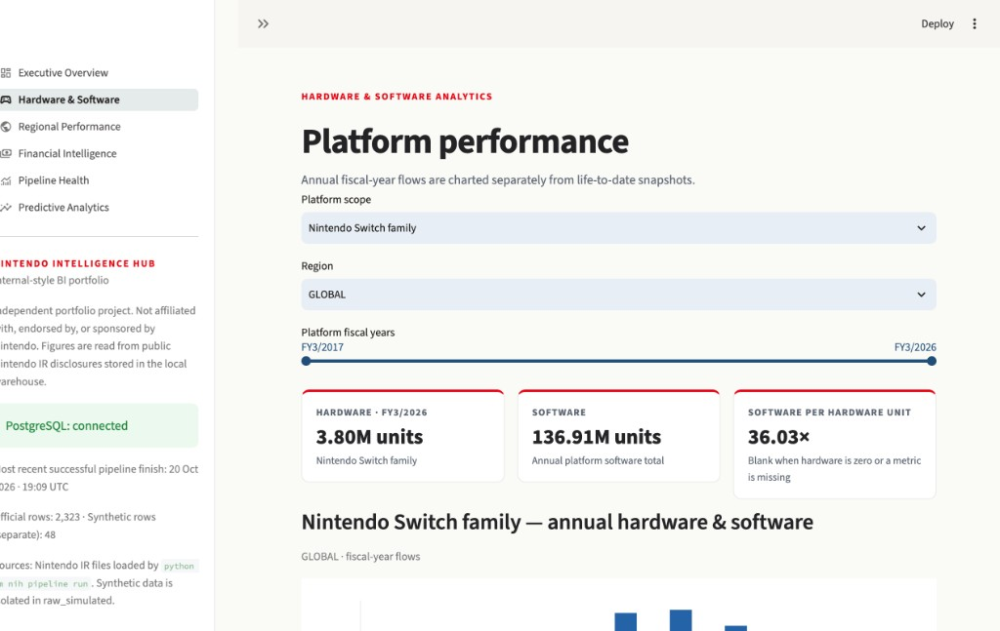
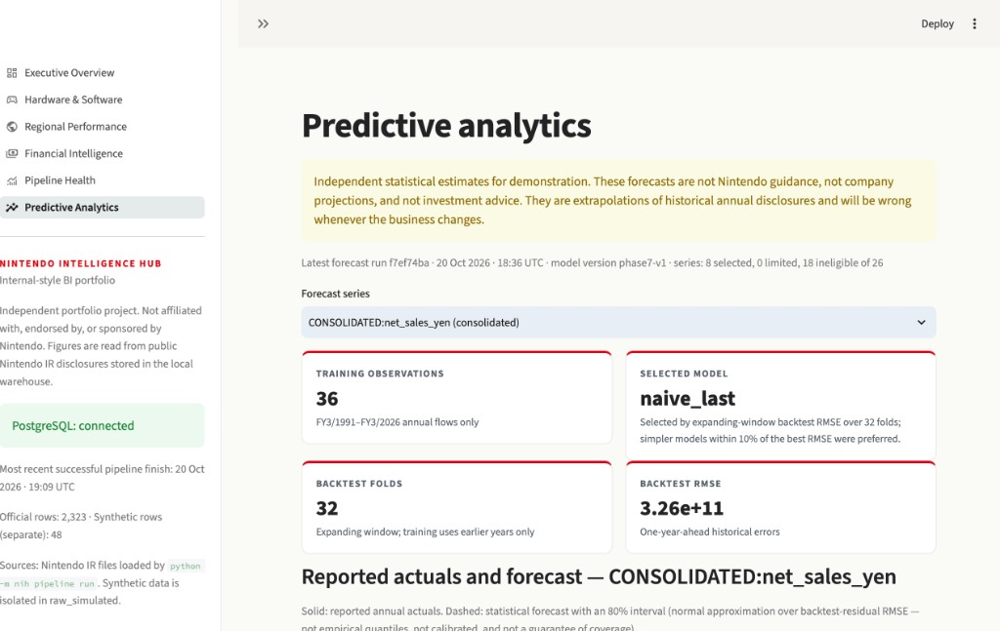
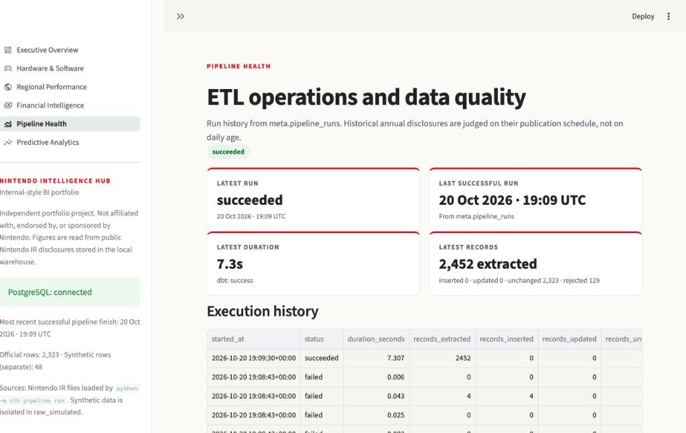
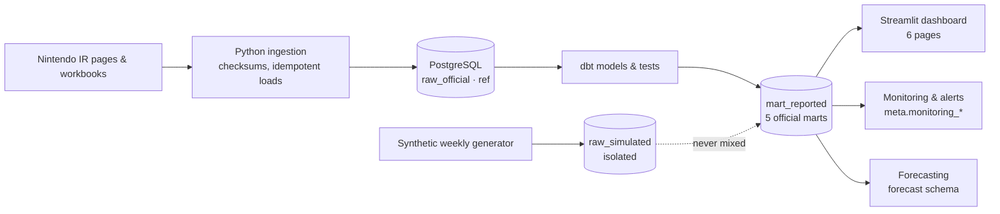

# Nintendo Intelligence Hub

An end-to-end business intelligence system built on **genuine Nintendo investor-relations disclosures**: automated ETL into PostgreSQL, dbt analytics marts, data-quality monitoring with anomaly detection, statistically backtested forecasting, and a six-page Streamlit dashboard.

> Independent portfolio project. Not affiliated with, endorsed by, or sponsored by Nintendo. Figures are read at runtime from public Nintendo IR disclosures stored in a local warehouse — no Nintendo figure is hardcoded in this repository. Forecasts are independent statistical estimates, never Nintendo guidance.

**Public demo:** not yet deployed. Deployment is fully prepared (read-only database role verified, Streamlit Cloud instructions in [docs/DEPLOYMENT.md](docs/DEPLOYMENT.md)); the remaining steps need the owner's cloud accounts — see [docs/DEPLOYMENT_CHECKLIST.md](docs/DEPLOYMENT_CHECKLIST.md).

## Dashboard preview

Screenshots of the live dashboard running against the local PostgreSQL warehouse. Every figure shown is queried from genuine Nintendo IR disclosures at runtime.



**Executive Overview** — the recruiter's starting point: worldwide annual hardware/software sell-in and consolidated financial KPIs for the selected fiscal year, with comparable year-over-year growth shown only when the same platform scopes reported in both years.



**Platform Performance** — per-platform annual flows with family/component double-counting prevented structurally, software attach rates, and life-to-date snapshots kept strictly separate from annual sales.



**Predictive Analytics** — backtested forecasts with the selected model, fold count, and error metrics on the same card row as the prediction, plus an explicit not-Nintendo-guidance disclaimer. On consolidated net sales the naive model honestly wins the backtest, and the page says so.



**Pipeline Health** — operational transparency: run history, durations, inserted/updated/unchanged record counts proving idempotent loads, plus monitoring alerts and source freshness below.

## The business problem

Nintendo reports hardware and software sell-in by platform and region, plus consolidated financials, in a mix of web pages and historical workbooks spanning decades of consoles. The reporting has traps: cumulative year-to-date columns that are not quarters, life-to-date snapshots next to annual flows, platform families that already include their component models, regional layouts that change definition over time, and disclosed negative values that are legitimate revisions. Any analyst who sums the wrong rows double-counts or mixes periods. This project builds the warehouse, safeguards, and analytics that make those figures safe to use.

## Architecture



**Stack:** Python 3.11 · PostgreSQL 16 · dbt · pandas · statsmodels · Streamlit · Plotly · pytest · Docker · GitHub Actions

## Verified data (live local warehouse)

| Dataset | Rows |
| --- | --- |
| Official unit-sales facts | 2,179 |
| Official financial facts | 144 (FY3/1991–FY3/2026, consolidated) |
| Annual platform mart | 1,968 |
| Regional mart | 1,483 |
| Hardware/software trends | 691 |
| Lifetime snapshots | 175 |
| Synthetic weekly rows (isolated, never in official marts) | 48 |

## Key features

- **ETL orchestration** — `python -m nih pipeline run` ingests, audits, builds dbt, and evaluates monitoring; checksum-based loads make reruns no-ops (verified: 2,323 records unchanged on rerun).
- **Monitoring & anomaly detection** — `python -m nih monitor run` checks duplicates, grain, schema, freshness, regional reconciliation, and annual business movements; alerts are fingerprint-deduplicated with an audited acknowledge/resolve/reopen lifecycle.
- **Forecasting** — `python -m nih forecast run` backtests 9 models (naive → ARIMA) with expanding windows, selects by RMSE with a simplicity preference, and stores forecasts with honest intervals in a separate schema. Retired and launch-year platforms are excluded by rule.
- **Dashboard** — Executive Overview, Hardware & Software, Regional Performance, Financial Intelligence, Pipeline Health, Predictive Analytics. Every figure is queried from PostgreSQL; nothing is typed in.
- **Tableau** — verified CSV exports of the five marts plus a step-by-step build guide ([docs/TABLEAU_BUILD_GUIDE.md](docs/TABLEAU_BUILD_GUIDE.md)).

## Data integrity safeguards

- Nintendo's fiscal year ends March 31; Q1–Q3 columns are cumulative year-to-date, **not** quarters. Incremental quarters are derived only from adjacent YTD spans — never from annual totals.
- Family totals already include component models; `GLOBAL` already includes regions; title rankings are inside platform software totals. Marts and dbt tests enforce all three.
- Life-to-date snapshots are never summed with annual flows; regional layouts (`europe_split` vs Europe-inside-Other) are never combined.
- Negative disclosed values are preserved as reported (returns/revisions), not "cleaned" away.
- A failed download changes nothing: loads are per-document and transactional, and unavailable sources are reported, never substituted.

## Testing

**Python: 103 passed. dbt: 72 results, 0 failures.** Suites cover fiscal/period logic, ingestion parsing, pipeline idempotency and failure modes, monitoring lifecycle, forecast leakage (a spy model proves training never sees the target year), and dashboard calculations. Run: `pytest` and `dbt build --project-dir transformations/dbt --profiles-dir transformations/dbt`.

## Local setup

```bash
python3 -m venv .venv && source .venv/bin/activate
pip install -e ".[dev]"
cp .env.example .env
docker compose up -d --wait
nih init-db
python -m nih pipeline run     # ingest + audit + dbt + monitoring
python -m nih forecast run     # backtested forecasts
streamlit run dashboards/app.py
```

## Go deeper

- [Portfolio case study](docs/PORTFOLIO_CASE_STUDY.md) — decisions, challenges, outcomes
- [Recruiter summary](docs/RECRUITER_SUMMARY.md) · [Demo script](docs/DEMO_SCRIPT.md)
- [Forecasting methodology](docs/FORECASTING_METHODOLOGY.md) · [Limitations](docs/FORECAST_LIMITATIONS.md)
- [Monitoring architecture](docs/MONITORING_ARCHITECTURE.md) · [Alert definitions](docs/ALERT_DEFINITIONS.md)
- [Data sources](docs/DATA_SOURCES.md) · [Business metrics](docs/BUSINESS_METRICS.md) · [Data grain](docs/DATA_GRAIN.md)
- [Deployment](docs/DEPLOYMENT.md) · [Production audit](docs/PRODUCTION_AUDIT.md)

## License

MIT. See [LICENSE](LICENSE).
