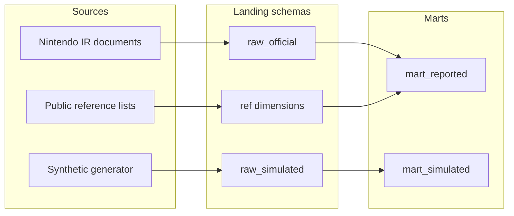

# Architecture

Nintendo Intelligence Hub is a local business-intelligence foundation. It is organized so a reported Nintendo figure can be traced to a public document, and so a synthetic operations series cannot be read as one of those figures.

## Layers

| Folder | Responsibility in this foundation |
| --- | --- |
| `ingestion` | Source catalog, official downloads and parsers, synthetic weekly generator |
| `transformations` | Year-to-date derivation and the dbt project |
| `warehouse` | PostgreSQL DDL, reference load, purity audit |
| `dashboards` | Streamlit shell and the fiscal-span chart |
| `forecasting` | scikit-learn baseline that accepts synthetic series |
| `monitoring` | Aggregate-collision checks and synthetic z-score alerts |
| `nih` | Settings, fiscal calendar, period contract, provenance |
| `config` | Settings, sources, and metric definitions |
| `docs` | Grain rules and the phased plan |
| `tests` | Unit tests and optional warehouse tests |

The warehouse target defaults to PostgreSQL on port 54329. BigQuery is a later target. Selecting it without `NIH_BIGQUERY_PROJECT` raises `ConfigurationError` instead of opening a cloud client.

## Schemas

| Schema | Contents |
| --- | --- |
| `ref` | Date, platform, region, game, game-platform bridge, and metric dimensions |
| `raw_official` | Disclosures as printed, after an explicit scale normalization |
| `raw_simulated` | Synthetic weekly sell-through |
| `staging` | dbt views over the landing tables |
| `mart_reported` | Annual, regional, lifetime, and financial marts, plus quarter derivations when adjacent year-to-date spans exist |
| `mart_simulated` | The synthetic weekly mart |
| `meta` | Document registry and load audit |

Raw fact tables do not use foreign keys to the dimensions. A later load can land a new platform code and a stewardship test can find it. The bridge table does reference `dim_game` and `dim_platform`, and it stays empty until reference titles are loaded.

## Two implementations of one rule

`nih.periods.derive_reported_incremental` is the warehouse-agnostic specification. The dbt macro `derive_ytd_incremental` is the PostgreSQL implementation. The warehouse test rolls back a synthetic pair and compares them. The Python result also lists quarters that cannot be derived. The SQL mart returns only the quarters it can derive.

dbt models use PostgreSQL syntax, including `DISTINCT ON`. A BigQuery phase replaces that macro. The Python contract stays the specification.

## What the bootstrap writes

`nih init-db` applies DDL, upserts platforms, regions, metrics, and the fiscal calendar, and reloads `synthetic_demo_weekly` into `raw_simulated`. It does not insert official unit or financial rows.
