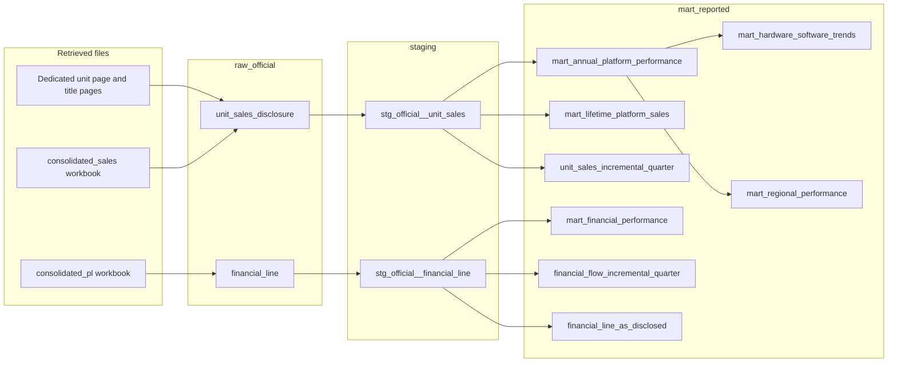

# Data lineage

Official measures move from a retrieved Nintendo file into `raw_official`, then through a staging view, then into `mart_reported`. The synthetic weekly series never joins that path.

`meta.source_document` supplies `source_url`, `content_sha256`, and the verbatim period label on the new marts. `ref.dim_platform` and `ref.dim_region` supply names. Additivity flags come from the fact row, not from the dimension.

`raw_simulated.weekly_sell_through` feeds only `mart_simulated.weekly_sell_through`.

## What each mart keeps

| Mart | Input grain it keeps | Input grain it drops |
| --- | --- | --- |
| `mart_annual_platform_performance` | `fiscal_year` hardware and software-total rows | Life-to-date, software titles, forecasts |
| `mart_hardware_software_trends` | Those annual rows for platforms that are not component models | Component models, so a family total is not paired twice |
| `mart_regional_performance` | The annual rows whose region is not `GLOBAL` | The worldwide row, which remains a column (`disclosed_global_units`) |
| `mart_lifetime_platform_sales` | `life_to_date` hardware and software-total rows, one per document and as-of date | Software titles, fiscal-year rows |
| `mart_financial_performance` | Fiscal-year consolidated income lines, pivoted to one row per year | Any non-fiscal-year span, and the unloaded ratio lines |
| `unit_sales_incremental_quarter` | Adjacent `q1`, `q1_q2`, `q1_q3`, and `fiscal_year` spans | A fiscal-year row that has no previous cumulative span |
| `financial_flow_incremental_quarter` | The same adjacent spans for additive yen flows | Stocks, forecasts, and a lone fiscal-year total |

When two documents report the same annual grain, the annual mart keeps the later `as_of_date`. Life-to-date documents are not collapsed. `is_latest_as_of` only marks the later snapshot.

## Provenance columns

`source_document_id`, `source_url`, `content_sha256`, `period_label_verbatim`, `as_of_date`, and `definition_note` stay on the observation. `observation_type` is `annual_flow` or `point_in_time_cumulative`. A calculated margin or software-per-hardware ratio is labeled as calculated.
