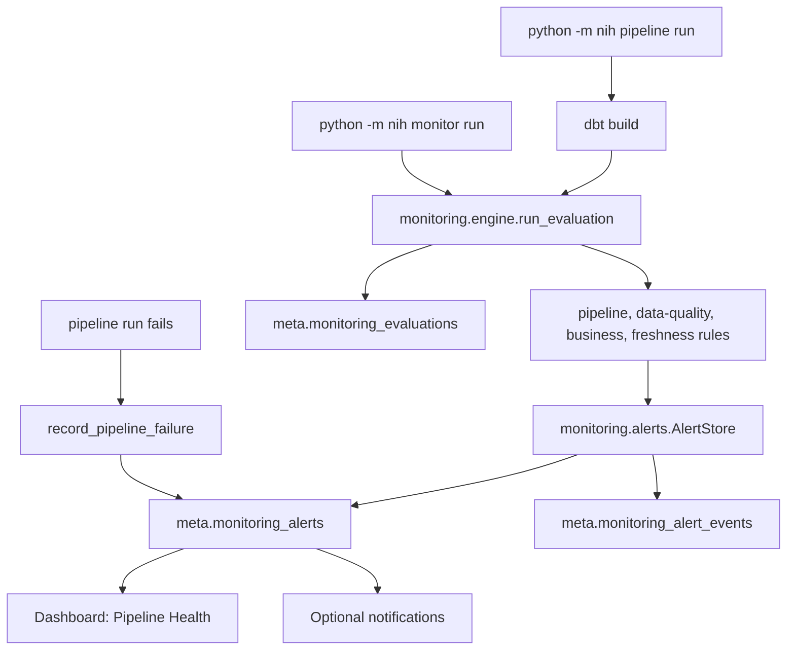

# Monitoring architecture

Monitoring is a persistent layer over the warehouse and the pipeline. It
never writes to a sales fact.

## Tables

| Table | Grain |
| --- | --- |
| `meta.monitoring_alerts` | One row per stable alert fingerprint |
| `meta.monitoring_alert_events` | One status transition (`created`, `seen`, `acknowledged`, `resolved`, `reopened`, `notified`) |
| `meta.monitoring_evaluations` | One monitoring evaluation, including its rule thresholds and document row-count snapshot |

The DDL is `warehouse/ddl/060_monitoring.sql`, applied by `nih init-db`
and created on demand by the monitoring commands.

## Fingerprint and lifecycle

A fingerprint hashes alert type, source, metric, platform, region,
reporting period, and source document. The observed value is not part of
it, so a corrected value updates the same alert.

| Situation | Result |
| --- | --- |
| Fingerprint is new | `active`, event `created` |
| Seen again while open | Values refreshed, `detection_count` rises, event `seen` |
| Seen again after resolution | Back to `active`, event `reopened` |
| Absent from a complete evaluation | `resolved` |
| Absent while the evaluation failed or was partial | Left open |
| Pipeline failure, then a later complete evaluation whose latest finished run succeeded | `resolved` by that specific rule |
| `ack` / `resolve` from the CLI | Status change with an audited event |

Re-running the pipeline or the monitor with unchanged data creates no
new alerts; the second evaluation reports `created=0`.

## When evaluation runs

- `python -m nih pipeline run` evaluates after a successful audit, dbt
  build, and mart verification. A monitoring failure makes that pipeline
  run fail rather than passing silently.
- `python -m nih monitor run` evaluates on demand and exits 1 when a
  rule fails.
- A pipeline run that fails records a critical `pipeline_failure` alert
  after its run row is finished, when PostgreSQL is reachable.
- Monitoring modules are imported lazily by the pipeline because the
  freshness rule reuses `nih.pipeline` helpers. There is no import cycle
  at module load.

## Exit codes

`monitor run` returns 0 when every rule evaluated, 1 when a rule failed,
and 2 from the CLI wrapper when the warehouse cannot be reached.
`monitor status` and `monitor history` return 0 on success. `ack` and
`resolve` return 1 when no alert matches.
