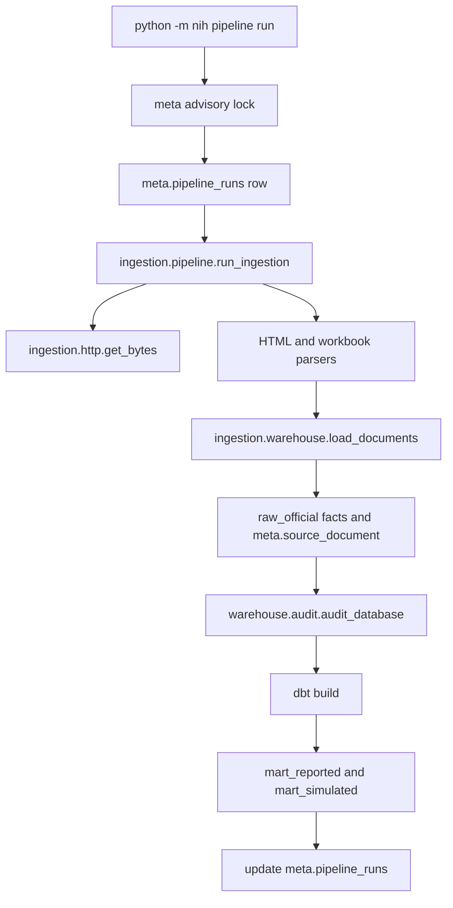

# Pipeline architecture

`nih.pipeline.run_pipeline` is the orchestrator. Parsing, period rules, and fact inserts stay in the ingestion and warehouse modules that already exist.

`raw_simulated` is loaded by `nih init-db`, not by this pipeline. The purity audit and the mart check both reject a simulated label inside an official fact or mart.

## Idempotency

Each parsed file has a SHA-256 checksum stored on `meta.source_document`.

| Situation | Warehouse action | Counters |
| --- | --- | --- |
| Document id is new | Insert the document and its rows in one transaction | `inserted` |
| Checksum and row count match | No delete and no insert | `unchanged` |
| Checksum differs | Compare grain keys, then replace only that document | `inserted`, `updated`, `unchanged`, `removed` |
| Download or parse fails | No statement touches that document | The run fails; existing rows remain |
| Optional source is not configured | No official rows are written | Warning on the run |

The replace is the existing delete-and-insert for one `source_document_id`. Other official documents and every simulated row stay in the transaction's untouched tables. A corrected disclosure therefore replaces its own rows without appending a second copy.

`load_audit` records the action. `pipeline_runs` records the execution.

## Lock

The lock is PostgreSQL advisory lock `84020401`, held on a session connection for the whole `pipeline run` or warehouse `nih ingest`. `load_documents` uses a second connection and does not take the lock again, so the load cannot deadlock on the orchestrator. A second pipeline or ingest exits 2 and writes a failed history row when the pipeline table is reachable. The first run's rows are not changed by the rejected attempt.

## Execution record

`meta.pipeline_runs` is one row per execution. The grain is the run id. It stores start and finish timestamps, status (`running`, `succeeded`, or `failed`), documents processed, extracted, inserted, updated, unchanged, and rejected counts, dbt status, validation-failure count, error text, duration, and a JSON detail payload for warnings and mart counts.

A `running` row whose process has gone away is marked failed the next time a run acquires the lock.

## Freshness

Status reads `as_of_date` from the official facts. The annual cadence is the March 31 close, recognized after 90 days. The quarterly cadence is the latest fiscal quarter-end that is at least 45 days old. The newest document in each group is the one that is judged. Daily age alone is not a failure.

## Logging

`nih.pipeline.configure_logging` writes `nih.*` logs as one line with `key=value` fields. Library code raises or returns a failed `PipelineResult`. It does not hide an exception from the run record. An unexpected exception is logged with a traceback and stored on the run before the command exits 1.

Network fetches already retry connection errors and HTTP 429, 500, 502, 503, and 504, three times, with a 30 second timeout. Other client errors fail immediately.
